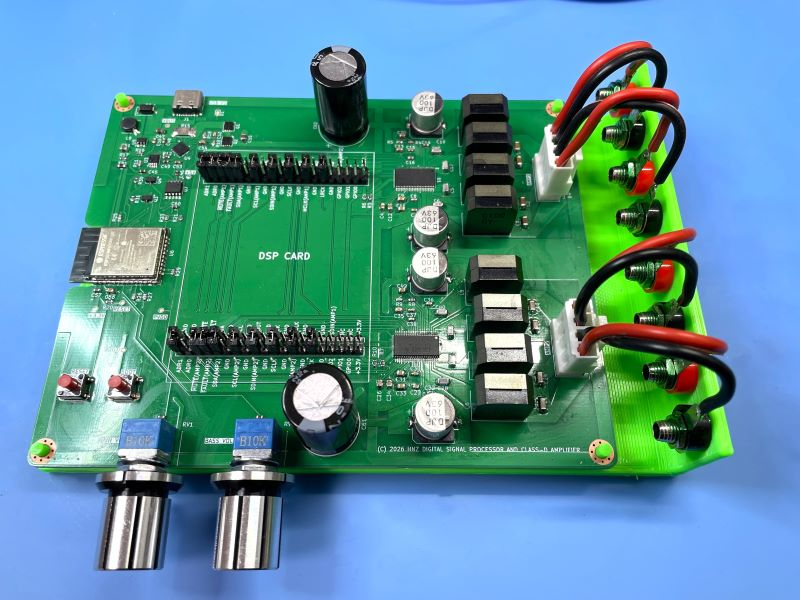
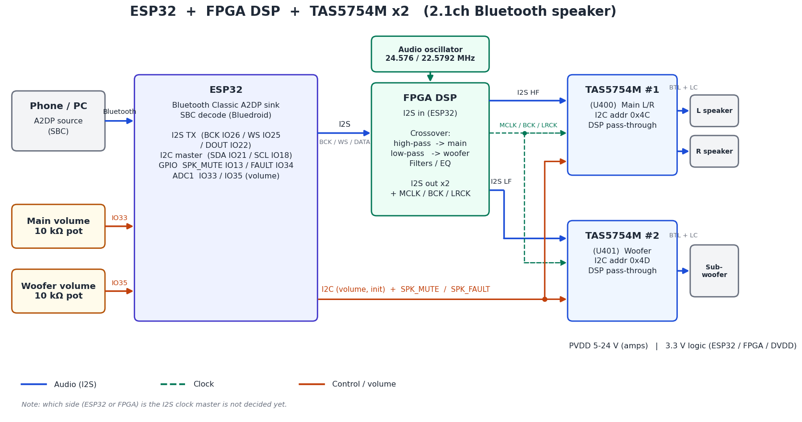
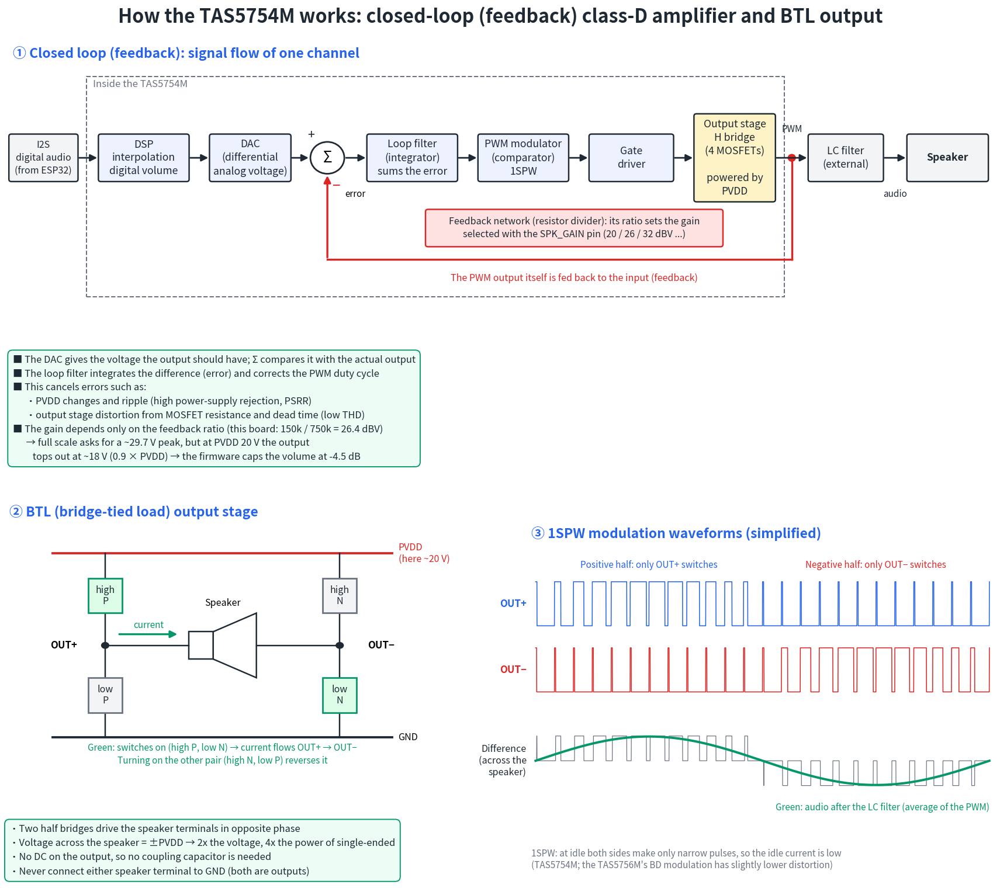
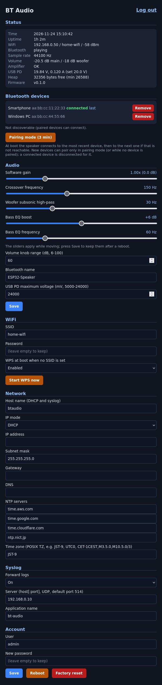

# bt-audio

A Bluetooth A2DP sink for the original ESP32, written in Rust. It receives
audio from a phone or PC over Bluetooth Classic and plays it through two
TAS5754M class-D amplifiers (main L/R and woofer) fed over I2S. The volume of
each amplifier is set with a potentiometer.





The diagram also shows the planned FPGA DSP stage (crossover and filters)
between the ESP32 and the amplifiers. Until it exists, the ESP32 is wired
straight to both amplifiers.

## How it works

```
Bluetooth (A2DP/SBC) -> Bluedroid decoder -> bounded channel -> I2S writer thread -> 2x TAS5754M
                                                       volume knobs (ADC) -> I2C ---^
```

- The ESP32 advertises itself as `ESP32-Speaker` and accepts pairing
  automatically (SSP numeric comparison, with a legacy PIN of `1234` as
  fallback).
- Several devices can be paired; Bluedroid keeps the bonds in NVS. A new
  device can pair only while the speaker is discoverable: 3 min after
  "Pairing mode" in the web UI, and always while no device is paired (being
  discoverable takes radio time from the audio stream). Paired devices can connect whenever no other device is
  connected.
- At boot the speaker connects to the paired device that connected last; if
  that one is not reachable it tries the next most recent, and so on (up to
  8 devices). The order and the device names are kept in NVS (`src/bt.rs`).
- The Bluedroid stack decodes SBC and hands 16-bit stereo PCM to a callback
  running on the Bluetooth task. The callback copies each packet into a
  jitter buffer (at most 32 KB, ~185 ms) and drops it if the buffer is full
  or the free heap would fall below 12 KB, so a slow I2S write never stalls
  the Bluetooth stack. The drops are logged every minute by reason (buffer
  full / heap short, with the lowest free heap at a heap-short drop).
- Playback starts once 80 ms of audio is buffered, and buffers again after
  the stream paused long enough to run dry. Some sources (Windows PCs) pause
  and then send a burst; the buffer rides that out. The I2S DMA holds another
  ~43 ms. The `i2s-writer` thread runs on CPU1 at priority 15, away from the
  Bluetooth and WiFi tasks on CPU0. The buffer keeps 16-bit PCM, half the memory of the 32-bit DMA
  slots. The minute log reports underruns and rebuffers during playback, and
  after a drop or underrun also the buffer level, its peak and the free heap.
- A separate `i2s-writer` thread applies a software gain, then writes to the
  I2S channel.
- The I2S sample rate follows the rate negotiated by the source (16, 32,
  44.1 or 48 kHz).
- The I2S master outputs MCLK, BCK and WS. The APLL is the clock source, so
  the clocks are exact and low-jitter; if it cannot produce a rate the driver
  falls back to the 160 MHz PLL and logs a warning. MCLK is set to 256 x fs,
  but the original ESP32 puts the I2S module clock on GPIO0, so the pin
  carries 512 x fs (22.58 MHz at 44.1 kHz), which the TAS5754M accepts. GPIO0
  runs at the strongest drive, because the BOOT switch and the auto-reset
  transistor on it round a weaker edge into a triangle.
- The 2.1ch crossover runs on the ESP32: 4th-order Linkwitz-Riley, 150 Hz by
  default, set with `crossover_hz` (50-300 Hz) in the web UI. L/R are high-passed for the main
  amplifier; the mono sum (L+R)/2 is low-passed for the woofer. The woofer path also has
  a subsonic high-pass (4th order, 30 Hz by default) against cone buzz, set
  with `subsonic_hz` in the web UI (applies at once, 0 = off), and a bass EQ
  (peaking boost, Q 0.9; `bass_eq_hz` 30-150 Hz, default 60 Hz, `bass_eq_db`
  0-12 dB, default +6 dB) to make up for the small woofer's low-end roll-off.
  Keep the subsonic filter on when boosting.
- Both TAS5754M share one data line. I2S runs with 32-bit slots (BCK = 64 x fs);
  each slot holds the 16-bit main sample in its upper half and the 16-bit
  woofer sample in its lower half. Over I2C both amplifiers are set to I2S
  16-bit input; the woofer amplifier also gets an I2S shift of 16 SCLKs
  (P0-R41) so it reads the lower half. Both woofer channels carry the same
  mono signal. Their own DSP stays at its default.
- A peak limiter on each path (main L/R linked, woofer) turns loud peaks down
  instead of hard-clipping them; low-passing the mono sum can push bass peaks
  past full scale. How often it engaged is logged every 60 s.
- Volume ceiling from PVDD: the amplifiers' SPK_GAIN/FREQ divider (150 kΩ /
  750 kΩ, about 5.8 V) selects the 26 dBV gain, at which digital full scale
  would need a ~30 V output peak. The firmware measures PVDD through the
  AP33772S every 5 s and limits the volume register so full scale stays
  within 90 % of PVDD (about -4.5 dB at 20 V, -16.5 dB at 5 V). Change
  `AMP_GAIN_DBV` if the divider changes.
- If the woofer amplifier does not answer at boot, the crossover is off and the
  main amplifier plays the full range.
- After Bluetooth and the audio path are up, a `net` thread joins the WiFi
  network (see [WiFi, web UI and syslog](#wifi-web-ui-and-syslog)); the audio
  path never waits on it.
- At start-up, before the I2S and the amplifiers, the firmware talks to the
  AP33772S USB PD sink controller on the same I2C bus (address `0x52`): it
  reads the source's PDOs, enables the UVP/OVP/OCP protections, requests the
  highest voltage the source offers up to the `pd_max_mv` setting (24 V by default; a fixed
  PDO counts at its own voltage, a PPS/AVS PDO up to its maximum) and switches
  VOUT on once the negotiation succeeds. A PPS / AVS contract needs no
  keep-alive from the firmware: the AP33772S repeats the request itself. At boot the firmware waits up to
  5 s for the source to start USB PD; a failed negotiation is retried every
  minute. After start-up only the `controls` thread talks to the AP33772S. If no voltage is available or the
  request fails, VOUT stays off and an error is logged. The sequence follows the wrapper in
  `uv-controller`.
- An amplifier that does not answer on I2C at boot is treated as not fitted:
  it is left alone until the next reboot and the other one runs on its own
  (the web UI shows it as "not connected"). The I2C driver is installed from a
  task pinned to CPU1, so its interrupt runs away from the Bluetooth
  controller and WiFi on CPU0; on CPU0 it had tripped the interrupt watchdog.
- A `controls` thread reads the two knobs every 20 ms (ADC spikes dropped,
  smoothed, with hysteresis so a knob left alone never moves the volume). The
  volume is applied digitally on the ESP32, ramped sample by sample and
  dithered to 16 bits, so turning a knob does not click; the amplifier volume
  registers stay at the PVDD ceiling and are only used to mute. The main
  knob is the master volume for both amplifiers (0 dB down to -60 dB; fully
  counter-clockwise mutes both). The
  bass knob sets the woofer level against it: the lower half goes from -12 dB
  below the master up to the master level at mid rotation (fully
  counter-clockwise mutes the woofer); the upper half goes from the master
  level up to the woofer's full output at the top, whatever the master is, so
  the woofer can play at full with the main speakers quiet. Full output is the
  PVDD ceiling plus up to +6 dB of digital boost, with the woofer limiter
  holding the peaks. A muted knob unmutes only once it is clearly past the
  mute point, so noise near the bottom of the rotation cannot switch the
  sound on and off. The thread also watches `SPK_FAULT` and clears a latched
  fault by toggling `SPK_MUTE`.
- `SPK_MUTE` is low (muted) at boot and whenever no stream is running, and
  high while audio plays. The amplifiers ramp the volume, so there are no pops.

### The TAS5754M amplifier: closed loop and BTL



Japanese version: [docs/tas5754m_closed_loop_btl_ja.png](docs/tas5754m_closed_loop_btl_ja.png)

- **Closed loop.** Inside the TAS5754M the I2S data goes through the DSP
  (interpolation filter, digital volume) to a DAC, which produces the voltage
  the output should have. The PWM output of the H bridge is fed back (before
  the external LC filter) and compared with it; a loop filter integrates the
  difference and corrects the PWM duty cycle. The loop cancels PVDD ripple and
  changes (high PSRR) and the distortion of the output stage (MOSFET
  resistance, dead time).
- **Gain.** The gain is set by the feedback ratio only, selected with the
  `SPK_GAIN/FREQ` pin. This board's 150 kΩ / 750 kΩ divider selects
  26.4 dBV, at which digital full scale asks for about a 29.7 V output peak.
  The output cannot swing past about 90 % of PVDD (about 18 V at 20 V), so the
  firmware caps the volume from the measured PVDD (-4.5 dB at 20 V).
- **BTL (bridge-tied load).** Each channel has two half bridges, `OUT+` and
  `OUT-`, driving the two speaker terminals in opposite phase. The voltage
  across the speaker swings ±PVDD: twice the voltage and four times the
  power of a single-ended output, with no DC on the speaker and so no
  coupling capacitor. Neither speaker terminal may be connected to GND.
- **1SPW modulation.** In the TAS5754M mostly one side switches at a time
  (`OUT+` on positive half-waves, `OUT-` on negative ones) and at idle both
  sides only make narrow pulses, so the idle current is low; the TAS5756M's
  BD modulation has slightly lower distortion instead. The waveforms in the
  diagram are simplified.

The Rust side lives in [src/main.rs](src/main.rs). A small C component,
[components/bt_shim](components/bt_shim), wraps the Bluetooth controller
start-up, the I2S driver, the I2C bus and the ADC, whose configuration macros
and structs are awkward to use from Rust.

## Hardware

- An original ESP32 (classic Bluetooth is not available on the S2, S3, C3 and
  later chips).
- Two TAS5754M amplifiers wired as in Figure 83 of the datasheet (2.2 dual
  stereo BTL schematic, [tas5754m.pdf](tas5754m.pdf)): U400 drives the main
  L/R speakers, U401 the woofer. Supplies: PVDD 5-24 V for the amplifiers and
  3.3 V for the logic, shared with the ESP32.
- An AP33772S USB PD sink controller board on the I2C bus (SDA/SCL below,
  address `0x52`); its VOUT is the PVDD supply, which the TAS5754M allows up
  to 26.4 V.
- Two 10 kΩ B-taper (linear) potentiometers for the main and woofer volume.
  The firmware maps the rotation to the volume in dB evenly. For A-taper
  (audio) pots set `POT_TAPER_MID` to 0.15 (15 % at half rotation) and the
  firmware undoes the A curve; the default 0.5 is for a linear B pot.
- 16 MB flash (the partition table and `sdkconfig.defaults` assume it; adjust
  `CONFIG_ESPTOOLPY_FLASHSIZE_*` for other sizes).

### Wiring

| Signal | ESP32 GPIO | TAS5754M pin (both amplifiers) |
|--------|-----------|-------------------------------|
| BCK | 26 | SCLK (23) |
| WS / LRCK | 25 | LRCK/FS (25) |
| DATA (DOUT) | 22 | SDIN (24) |
| MCLK | 0 | MCLK (22) |
| SDA | 21 | SDA (16), 4.7 kΩ pull-up to 3.3 V |
| SCL | 18 | SCL (17), 4.7 kΩ pull-up to 3.3 V |
| Mute | 13 | SPK_MUTE (27), 100 kΩ pull-down to GND |
| Fault | 34 | SPK_FAULT (40), 10 kΩ pull-up to 3.3 V |
| Main volume | 33 (ADC1) | wiper of the main potentiometer |
| Woofer volume | 35 (ADC1) | wiper of the woofer potentiometer |

The pins are constants at the top of [src/main.rs](src/main.rs). Details:

- **I2C bus:** it runs at 100 kHz (the speed used by `uv-controller` for the
  AP33772S). The AP33772S (`0x52`) and the amplifiers (`0x4C`, `0x4D`) share it.
- **I2C addresses:** strap `ADR0`/`ADR1` so that U400 (main) is `0x4C`
  (`ADR0` = GND, `ADR1` = GND) and U401 (woofer) is `0x4D` (`ADR0` = 3.3 V,
  `ADR1` = GND).
- **MCLK on GPIO0:** the ESP32 can output MCLK only on GPIO0, 1 or 3. GPIO0 is
  a boot strapping pin: power the amplifiers' DVDD from the same 3.3 V rail as
  the ESP32 so that their MCLK input never holds GPIO0 low at boot.
- **Potentiometers:** connect one end to 3.3 V and the other through a 1 kΩ
  resistor to GND, the wiper to the GPIO and a 0.1 µF capacitor from the
  wiper to GND. Both pins are on ADC1, which works with Bluetooth active. The
  resistor lifts the counter-clockwise stop to about 0.3 V, above the ESP32
  ADC's dead zone (below ~0.15 V), so the knob has no slack at that end. The
  firmware learns the stop reading (the lowest reading seen, kept in NVS as
  `knob_floor33` / `knob_floor35`) and mutes within 20 counts of it; until
  the knob has been turned to its stop once, it mutes below 520. A factory
  reset erases the learned value.
- **Clock signals:** a 33 Ω series resistor near the ESP32 on each of BCK, WS,
  MCLK and DOUT reduces ringing and EMI.
- Leave the amplifiers' `GPIO0/1/2` unconnected. The output filters, PVDD
  network and the `SPK_GAIN/FREQ` divider follow the datasheet schematic.

> **Keep GPIO6-11 clear.** These pins connect the module to its internal SPI
> flash. If they are wired to anything external, noise can corrupt
> instruction fetches and cause random `IllegalInstruction` panics, typically
> when Bluetooth audio starts.

## WiFi, web UI and syslog

The settings are stored in NVS (namespace `btaudio_cfg`) and edited in a web
UI. The WiFi, WPS and syslog code follows the one in eew-display.

**WiFi and WPS.** With no SSID stored and WPS enabled (the default), the
firmware starts a WPS push-button handshake at boot: press the WPS button on
the router within 120 s. The received SSID and passphrase are saved to NVS,
so the next boot connects directly. A station that is not connected retries
every 30 s. The WiFi modem sleeps between beacons (`WIFI_PS_MIN_MODEM`) to
leave airtime for the Bluetooth stream. WPS can also be started later from the
web UI ("Start WPS now"). There is no access-point mode.

**Web UI.** Once connected, open `http://<host name or IP address>/` (the IP
address is in the log: `WiFi up, IP address ...`). Log in with the default
user `admin` and password `btpass` (set in [cfg.toml](cfg.toml)), and change
them under "Account". The server speaks plain HTTP, so use it on a trusted
network only.



The page has these sections, from the top (the screenshot shows sample
values):

- **Status**, refreshed every 5 s: local time, uptime, WiFi address / SSID /
  RSSI, Bluetooth state (not connected / connected / playing), sample rate,
  the volume of each amplifier, amplifier fault, the measured USB PD voltage
  and current with the requested voltage, free heap (and its minimum since
  boot), firmware version.
- **Bluetooth devices**: the paired devices, most recently connected first,
  with name, address, `connected` and `last` (tried first at boot).
  "Remove" forgets a device (it is disconnected first). "Pairing mode
  (3 min)" makes the speaker discoverable so a new device can pair; a
  connected device is disconnected for it, since the speaker cannot be found
  while connected. The line above the button shows whether the speaker is
  discoverable and for how long.
- **Audio**: software gain, crossover frequency, woofer subsonic high-pass,
  bass EQ boost and frequency. The sliders apply while moving
  (`/api/live`) and are kept after a reboot only when saved. Also the volume
  knob range (applied at once), the Bluetooth name and the USB PD maximum
  voltage (both after a reboot).
- **WiFi**: SSID, password, WPS at boot when no SSID is set (after a reboot);
  "Start WPS now" starts a WPS push-button handshake at once.
- **Network**: host name (DHCP and syslog), DHCP or static IP address,
  subnet mask, gateway, DNS, four NTP servers (after a reboot), and the time
  zone as a POSIX TZ string (default `JST-9`, applied at once).
- **Syslog**: forwarding on/off, server `host[:port]` (UDP, port 514 by
  default) and application name (applied at once).
- **Account**: web UI user and password (after a reboot).

"Save" stores every section. "Reboot" restarts the ESP32; "Factory reset"
erases the settings and the learned knob stops (not the paired devices) and
reboots. The passwords are never sent back to the browser; leave a password
field empty to keep it.

<br clear="right">

**Syslog.** When enabled, every log record is also sent to the syslog server
as an RFC 5424 message over UDP (facility user, app name `bt-audio`, host name
from the settings). The timestamp is the local time (from SNTP and the time-zone
setting) with its UTC offset, e.g. `2026-11-17T23:53:01+09:00`, and is `-`
until the clock has been set. The log is always written to the serial console as well.
Messages are queued and sent by a separate thread, so logging never blocks the
Bluetooth tasks; they are dropped if the queue is full.

**Memory.** WiFi and the web server share the heap with Bluetooth (about 129 KB
free with Bluetooth alone). The WiFi buffers and sockets are reduced in
[sdkconfig.defaults](sdkconfig.defaults) and A-MPDU is disabled. After the
network is up the log prints `heap free ... bytes, minimum ...`, and the web UI
shows the same: check the minimum while a stream plays and the UI is in use.

## Building and flashing

### 1. Set up the environment

On Ubuntu / Debian (including WSL2), run the setup script once:

```sh
bash setup_env.sh
```

It installs the system packages, Rust (rustup), `ldproxy`, `espup` and
`cargo-espflash`, the Xtensa toolchain for the ESP32 (`espup install
--targets esp32`), and adds your user to the `dialout` group for serial port
access (log out and back in afterwards).

In every new terminal, load the Rust and ESP environments before building:

```sh
source "$HOME/.cargo/env"
source "$HOME/export-esp.sh"
```

ESP-IDF v5.2.2 is downloaded and built automatically by `esp-idf-sys` on the
first build, which takes a while.

### 2. Build and flash

```sh
cargo build --release
cargo espflash flash --release --monitor --port /dev/ttyUSB0
```

The target, ESP-IDF version and `build-std` are configured in
[.cargo/config.toml](.cargo/config.toml). The partition table is
[partitions.csv](partitions.csv): a single 3 MB factory app, because the
default 1 MB partition is too small with Bluedroid.

Press `Ctrl+R` in the monitor to reset the chip. This works when the
USB-serial chip's DTR/RTS lines are wired to EN and GPIO0, as on most
development boards.

## Configuration

Constants in [src/main.rs](src/main.rs):

| Constant | Default | Meaning |
|----------|---------|---------|
| `DEFAULT_SAMPLE_RATE` | `44_100` | I2S rate before the source negotiates one |
| `GAIN_Q8` | `256` | Initial software gain in Q8 fixed point (256 = 1.0x); the setting from the web UI replaces it |
| `PREFILL_MS` | `80` | Audio buffered before playback starts or resumes after running dry |
| `QUEUE_MAX_BYTES` | 32 KB | Most PCM buffered between the Bluetooth task and the I2S writer (~185 ms at 44.1 kHz) |
| `HEAP_FLOOR` | 12 KB | A packet is dropped rather than buffered when the free heap would fall below this |
| `PIN_BCK`, `PIN_WS`, `PIN_DOUT`, `PIN_MCLK` | 26, 25, 22, 0 | I2S pins |
| `PIN_SDA`, `PIN_SCL` | 21, 18 | I2C pins |
| `AMP_MAIN`, `AMP_WOOFER` | `0x4C`, `0x4D` | Amplifier I2C addresses (7-bit) |
| `PIN_MUTE`, `PIN_FAULT` | 13, 34 | `SPK_MUTE` output, `SPK_FAULT` input |
| `PD_LOG_INTERVAL` | 60 s | How often the measured USB PD voltage and current are logged |
| `PD_POLL_INTERVAL` | 5 s | USB PD polling: measures the output for the log and the web UI; a failed negotiation is retried every minute |
| `CURRENT_SAMPLE_INTERVAL` | 200 ms | USB PD output current sampling; the log line every 60 s shows `PD <mV>, <avg> mA avg / <max> mA max` (24 mA resolution) |
| `PIN_VOL_MAIN`, `PIN_VOL_WOOFER` | 33, 35 | Master volume and bass knob ADC pins |
| `BASS_RANGE_STEPS` | `24` | Bass knob range in 0.5 dB steps either side of 0 dB (24 = +-12 dB) |
| `VOL_RANGE_STEPS` | `120` | Initial knob range in 0.5 dB steps (120 = 0 to -60 dB); the `vol_range_db` setting replaces it |

Build-time settings are in [sdkconfig.defaults](sdkconfig.defaults): classic
Bluetooth only (BR/EDR), Bluedroid with A2DP and SSP, a custom partition
table, and 16 MB flash.

## Troubleshooting

- **Random `IllegalInstruction` panics or garbled backtraces**: check the
  flash pins (GPIO6-11) and keep wiring away from the antenna. Lowering the
  flash clock with `CONFIG_ESPTOOLPY_FLASHFREQ_20M=y` (and flashing with
  `-f 20mhz`) can help as a diagnostic, but removing the noise source is the
  real fix.
- **Distorted sound**: lower the software gain (above 256 clips) and the volume knobs,
  and check the source volume, the PVDD supply and the speaker wiring.
- **No sound but connected**: check the log for `audio state 1` and for
  `amp 0x4c ready` / `amp 0x4d ready`. A failed I2C write is logged as
  `amp ... init failed`: check SDA/SCL, the pull-ups and the `ADR0`/`ADR1`
  straps. Verify that `SPK_MUTE` is high while playing.
- **No PD output**: the log lists the source's PDOs (`PDO n: ... mV`) and then
  `USB PD output on` or `USB PD output not enabled: ...`. The log also shows
  `selected ... mV`, the highest voltage offered up to the `pd_max_mv` setting.
- **Clock errors on the amplifiers**: the `clock status` value in the
  `amp ... ready` log line is `P0-R94` of the TAS5754M; `0x00` means MCLK, SCLK
  and the sampling rate are valid. Check the MCLK wiring if it is not.
- **`SPK_FAULT` messages**: the amplifier reports over-current, over-temperature,
  under/over-voltage or a DC fault; check the speaker wiring and PVDD.

## Limitations

- SBC only; no AAC or other codecs.
- No AVRCP (volume and playback control from the sink side).
- One connection at a time; the device stops being discoverable while
  connected. No reconnect after a link loss (only at boot).
- The crossover and filters run on the ESP32 for now; the planned FPGA stage
  between the ESP32 and the amplifiers would take them over.

## License

**Software** (firmware, [src/](src/), [components/](components/)): MIT License.
Copyright (c) 2026 Hiroshi Nakajima. The license is declared in the header of
[src/main.rs](src/main.rs) (`SPDX-License-Identifier: MIT`) and in
[Cargo.toml](Cargo.toml) (`license = "MIT"`).

**Hardware** (schematic, PCB layout, BOM and production files in [hw/](hw/)):
[Creative Commons Attribution-ShareAlike 4.0 International](https://creativecommons.org/licenses/by-sa/4.0/)
(CC BY-SA 4.0). Copyright (c) 2026 Hiroshi Nakajima. You may copy, modify,
manufacture and sell boards made from these files, provided you credit the
author and release modified design files under the same license.
